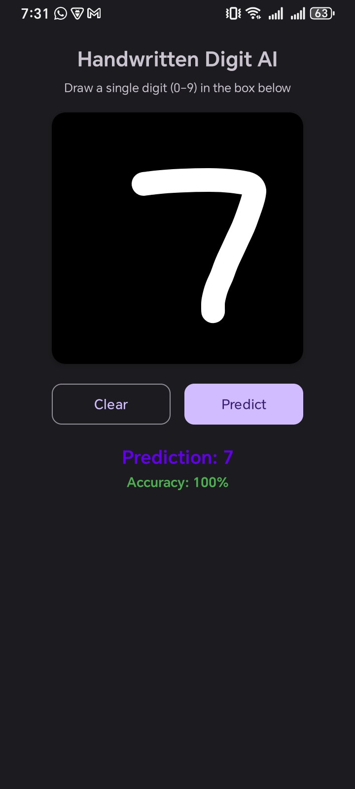
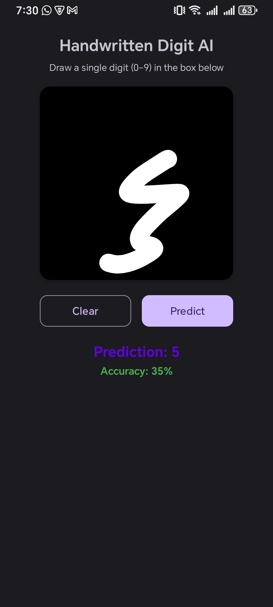

# Handwritten Digit Recognition AI Application

An Android application that recognizes handwritten digits (0–9) using a Convolutional Neural Network (CNN) and TensorFlow Lite.

Users can draw a digit on the screen, and the application predicts the digit with a confidence score.

## 📱 Application Screenshots

### Digit Recognition – 7



### Digit Recognition – 3



## ✨ Features

- Draw handwritten digits from 0 to 9.
- Interactive drawing canvas.
- Clear button to remove the drawing.
- Predict button to recognize the digit.
- Prediction result displayed on the screen.
- Confidence score for the prediction.
- Offline prediction using TensorFlow Lite.
- Simple and user-friendly interface.

## 🧠 Machine Learning Model

The application uses a Convolutional Neural Network (CNN) trained on the MNIST handwritten digit dataset.

**Model details:**

- Model type: CNN
- Dataset: MNIST
- Input image size: 28 × 28 pixels
- Input format: Grayscale image
- Number of classes: 10
- Supported digits: 0–9
- Model format: TensorFlow Lite (`.tflite`)
- Model file: `digit_recognition.tflite`

The trained model is integrated into the Android application using the TensorFlow Lite Interpreter.

## 🛠️ Technologies Used

- Java
- XML
- Android Studio
- TensorFlow Lite
- Python
- TensorFlow / Keras
- CNN
- MNIST Dataset
- Gradle

## ⚙️ How It Works

1. The user draws a digit on the drawing canvas.
2. The application captures the drawing as a bitmap.
3. The image is resized to 28 × 28 pixels.
4. The image is converted into grayscale and normalized.
5. The processed image is passed to the TensorFlow Lite model.
6. The model predicts the digit.
7. The application displays the predicted digit and confidence score.

## 📂 Project Structure

```text
Handwritten-Digit-Recognition-AI-Application/
│
├── project/
│   ├── .idea/
│   ├── Screenshots/
│   ├── app/
│   │   ├── src/
│   │   │   └── main/
│   │   │       ├── java/
│   │   │       ├── res/
│   │   │       └── assets/
│   │   │           └── digit_recognition.tflite
│   │   └── build.gradle
│   ├── build.gradle
│   └── settings.gradle
│
└── README.md
```

*The structure above is a simplified representation. Actual files may vary.*

## 🚀 How to Run the Project

1. Download or clone this repository.
2. Open Android Studio.
3. Select **Open** and choose the Android project folder inside `project/`.
4. Wait for Gradle synchronization to complete.
5. Connect an Android device or start an emulator.
6. Run the application.

## 🧪 Testing Results

| Test | Actual Digit | Predicted Digit | Confidence |
|---|---:|---:|---:|
| 1 | 7 | 7 | 100% |
| 2 | 3 | 5 | 35% |

These are sample application tests, not overall model accuracy measurements.

## 📚 Dataset

The model uses the MNIST handwritten digit dataset.

Dataset reference:

https://yann.lecun.com/exdb/mnist/

## 📖 Learning Outcomes

This project demonstrates practical experience with:

- Android application development.
- Deep learning model integration.
- TensorFlow Lite Interpreter.
- Image preprocessing.
- Handwritten digit classification.
- Mobile AI application testing.

## 👨‍💻 Developer

**Ali Hamza Azam**

GitHub: https://github.com/ALi-Hamza-88

## 📄 License

This project is developed for educational purposes as part of an academic assignment.

