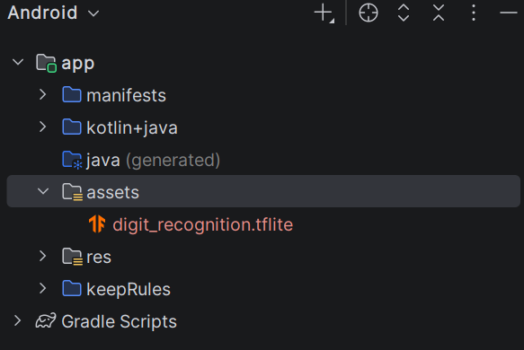
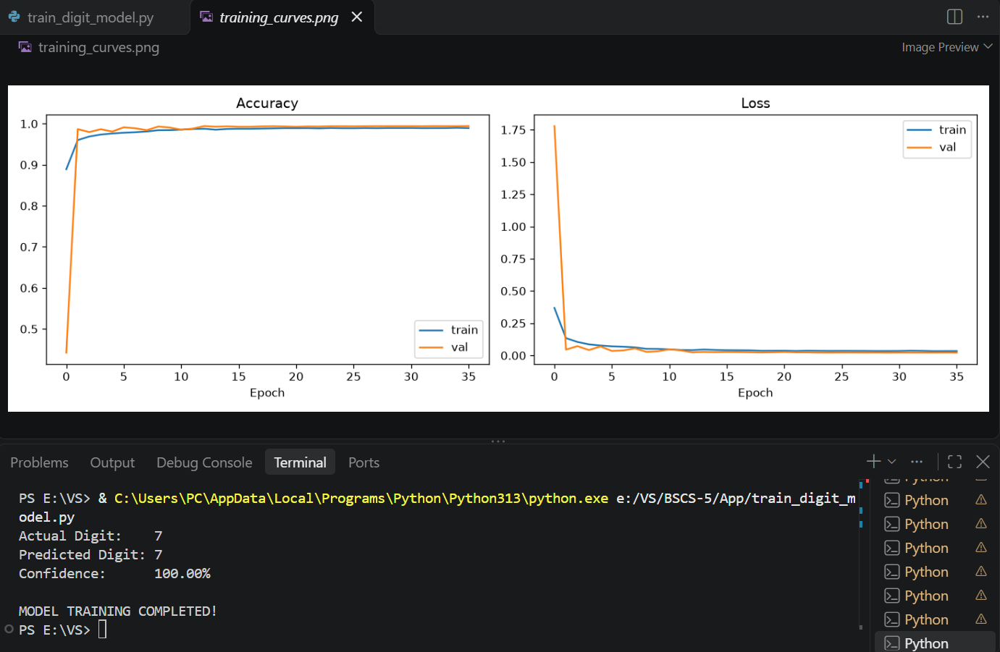
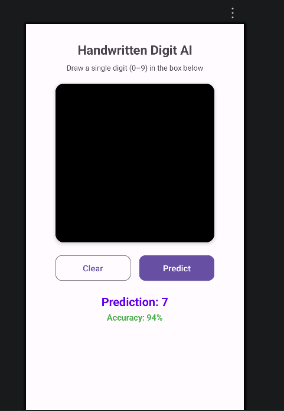
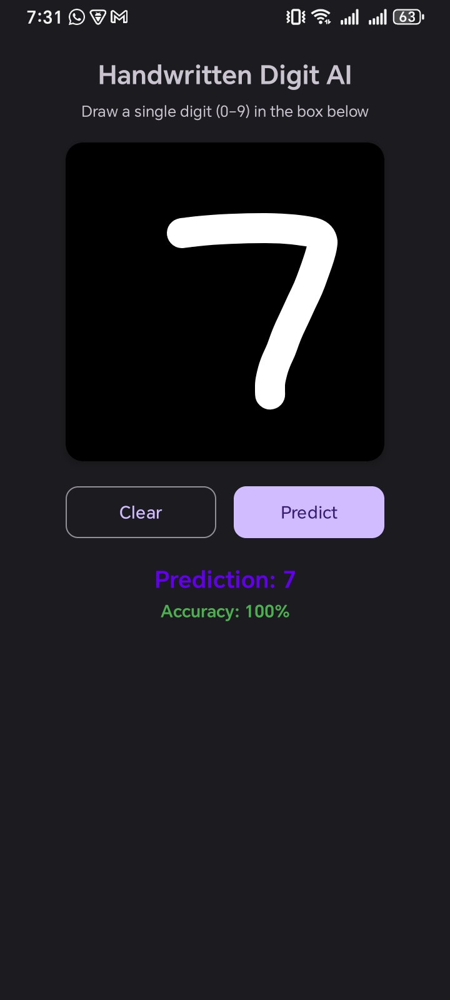
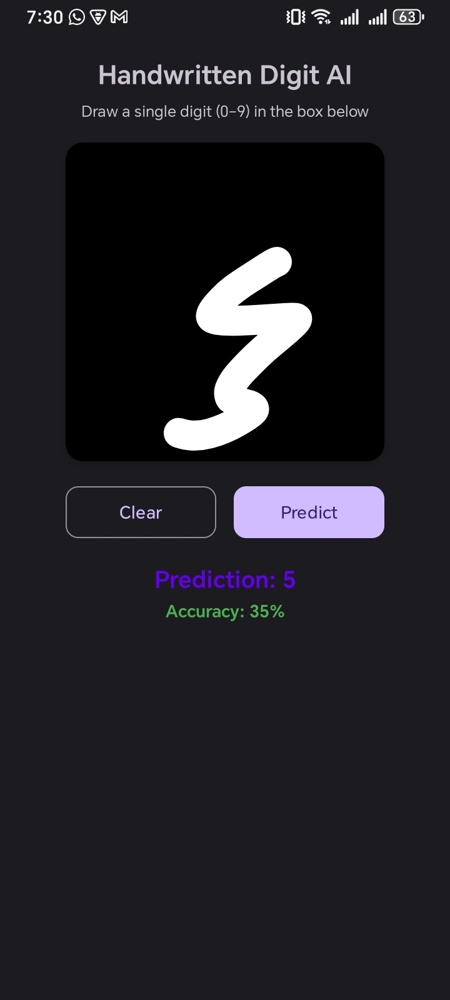

# INSTITUTE OF SPACE TECHNOLOGY
## KICSIT, Kahuta Campus

 

# ASSIGNMENT NO. 2

## AI-Based Mini Application Development

### Integrating ML/DL Models into Android with TensorFlow Lite

### LAB / PRACTICAL REPORT

**BSCS-5B**

------------------------------------------------------------------------

**NAME:** Ali Hamza Azam

**REGISTRATION NO.:** 242201088

**SERIAL NO.:** 38

**SUBJECT:** Mobile App Developement

**PROJECT TITLE:** Handwritten Digit Recognition AI Application

**SUBMITTED TO:** Sir Uzair

**SUBMISSION DATE:** 06/11/2026

------------------------------------------------------------------------

# 1. Introduction

In this practical assignment, a Handwritten Digit Recognition Android
application was developed using Java and TensorFlow Lite.

The application allows users to draw a handwritten digit from 0 to 9. A
trained CNN model processes the drawing and predicts the digit.

The application contains a drawing canvas, Clear button, Predict button,
prediction result, and confidence score.

# 2. Objectives

The main objectives of this practical are:

1.  To understand the integration of deep learning models into Android
    applications.
2.  To use TensorFlow Lite for running a trained model.
3.  To process handwritten images before prediction.
4.  To create an interactive Android user interface.
5.  To test the application using different handwritten digits.

# 3. Tools and Technologies

  Tool / Technology   Purpose
  ------------------- ------------------------------------
  Android Studio      Developing the Android application
  Java                Writing application logic
  XML                 Designing the interface
  TensorFlow Lite     Running the model
  CNN                 Digit recognition
  MNIST               Training dataset
  Gradle              Managing dependencies

# 4. Practical Implementation

## 4.1 Creating the Android Project

An Android project was opened or created in Android Studio. The project
uses Java for application logic and XML for the user interface.

  
   
  <strong>Screenshot 1: Android Studio project structure</strong>

## 4.2 Preparing the Deep Learning Model

A Convolutional Neural Network (CNN) model is used to recognize
handwritten digits from the MNIST dataset. The model is converted to
TensorFlow Lite format so it can run in the Android application.

The model file used by the application is:

`digit_recognition.tflite`

The model should be placed in the Android application's assets
directory.

  
   
  <strong>Screenshot 2: Model training or conversion output</strong>

## 4.3 Designing the User Interface

The application interface was designed using XML. It contains:

-   Application heading and instructions.
-   Drawing canvas.
-   Clear button.
-   Predict button.
-   Prediction result.
-   Confidence percentage.

The interface uses a white background, a black drawing area, and purple
buttons.

  
   
  <strong>Screenshot 3: Application interface</strong>

## 4.4 DrawingView Implementation

A custom drawing view allows users to draw digits using their fingers.
It captures touch events and displays the drawing using a white stroke
on a black background.

The Clear button removes the current drawing so that another digit can
be entered.

## 4.5 Image Preprocessing

Before the drawing is passed to the model, the application prepares the
image. The process includes:

1.  Capturing the drawing as a bitmap.
2.  Resizing the bitmap to 28 × 28 pixels.
3.  Converting pixels to grayscale.
4.  Normalizing pixel values according to the model's expected input.
5.  Storing the processed values in a `ByteBuffer` or the input format
    required by the model.

Correct preprocessing is important because the model expects input in a
specific format.

## 4.6 TensorFlow Lite Integration

The TensorFlow Lite Interpreter is used to execute the model in the
Android application.

The application loads the `.tflite` model from its assets, prepares the
input data, runs inference, and reads the output scores for the ten
possible digits (0--9).

The digit with the highest output score is selected as the prediction.

## 4.7 Prediction Functionality

When the user presses the Predict button, the application processes the
drawing and passes it to the model. The predicted digit and its
displayed confidence score are then shown on the screen.

# 5. Application Testing

The application was tested by drawing handwritten digits on the canvas.

## 5.1 Test Case 1: Recognition of Digit 7

-   **Input:** User draws digit 7.
-   **Expected output:** 7.
-   **Actual output:** 7.
-   **Displayed confidence:** 100%.
-   **Result:** Correct prediction.

  
   
  <strong>Figure 1: Recognition of Digit 7</strong>

## 5.2 Test Case 2: Recognition of Digit 3

-   **Input:** User draws digit 5.
-   **Expected output:** 5.
-   **Actual output:** 5.
-   **Displayed confidence:** 35%.
-   **Result:** Correct prediction.

  
   
  <strong>Figure 1: Recognition of Digit 7</strong>

## 5.3 Testing Summary

  -----------------------------------------------------------------------
  Test           Actual Digit Predicted Digit       Displayed Result
                                                   Confidence 
  ----------- --------------- --------------- --------------- -----------
  1                         7               7            100% Passed

  2                         3               5             35% Failed
  -----------------------------------------------------------------------

The first test correctly recognized digit 7. In the second test, the
model predicted 5 instead of 3. This demonstrates that handwriting shape
and image preprocessing can affect predictions.

**Note:** The percentage displayed by the application is prediction
confidence, not the overall accuracy of the trained model. Overall model
accuracy must be measured using a labelled test dataset.

# 6. Practical Challenges

The main development and testing challenges included:

1.  Preparing handwritten images in the required input dimensions.
2.  Converting the trained model into TensorFlow Lite format.
3.  Loading the model from Android assets.
4.  Providing input data in the correct tensor format.
5.  Handling different handwriting styles.
6.  Displaying prediction results correctly.

# 7. Learning Outcomes

After completing this practical, I learned:

-   How to develop an Android application using Java.
-   How to integrate a TensorFlow Lite model.
-   How to process bitmap images.
-   How a CNN performs image classification.
-   How to use the TensorFlow Lite Interpreter.
-   How to test an AI-based Android application.

# 8. Conclusion

In this practical assignment, a Handwritten Digit Recognition AI
application was developed using Android Studio and TensorFlow Lite.

The application allows users to draw digits and receive predictions
directly on their mobile devices. The practical work provided experience
in model integration, image preprocessing, inference, and Android
interface development.

The tests showed one correct prediction and one incorrect prediction,
demonstrating that model predictions can vary with handwriting style and
input quality.
